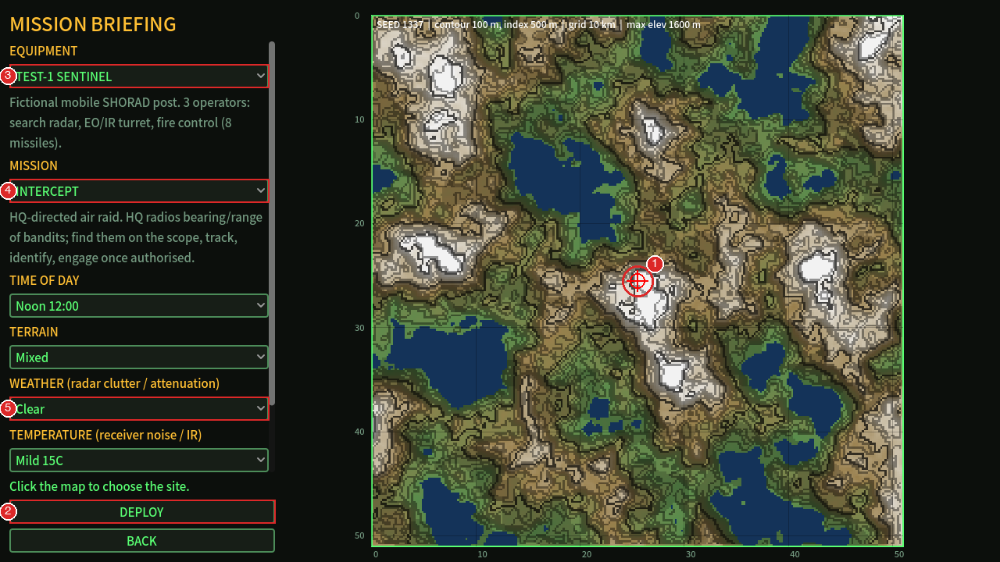

# Last Line

방공 장비 오퍼레이터 시뮬레이터. 유저는 장비 안쪽 조작반 앞에 앉은 오퍼레이터가 되어, 레이더 에코를 읽고 열상/TV 카메라로 표적을 식별하고, 무전을 들으며 요격하거나 보고한다.
Godot 4.7 (GL Compatibility), 웹 브라우저 플레이 전제, 마우스만으로 조작한다.

> 현재 장비는 모두 **가상의 테스트 장비**이며 제원은 가상 수치다. 실제 장비 이식은 `equipment.gd` 데이터와 스테이션 스크립트로 확장하도록 설계했다.



## 특징

- **실제 같은 레이더 영상**: 점 마커 대신 원시 에코 영상. 회전 빔이 지나갈 때마다 화면이 갱신되고 인광 잔광이 남는다. 지형 클러터, 산 뒤 **레이더 음영**, 비구름, 수신기 열잡음, 번개 잡음, 대기 덕팅이 모두 영상에 나타난다.
- **오퍼레이터별 장비 화면**: 레이더 / EO(TV·열상) / 사격통제. 한 장비에 여러 오퍼레이터가 붙는 구조.
- **seed 기반 지도**: 같은 seed는 같은 맵. 산지·평원·계곡·바다·숲 바이옴, 등고선 지형도에서 사이트 지정.
- **지형·날씨·기온·시간대**가 센서 성능에 실제로 영향을 준다(음영, 감쇠, 광량, IR 대비).
- **무전 시스템**: HQ와 분대원의 무전이 영어 음성(신경망 TTS, 무전기 필터)과 반투명 자막(영어 + 한국어)으로 계속 들어온다.
- **효과음**: 스위치·릴레이·서보 모터·경보·미사일 발사·폭발까지 코드로 합성(에셋 없음).
- **미션**: 요격(HQ 지시, 교전 규칙 적용), 아군 지원, 탐지·보고.
- 캠페인/시나리오로 확장하기 쉬운 데이터 중심 구조.

## 빠른 시작

1. [Godot 4.7](https://godotengine.org)로 `last-line/project.godot`를 연다(최초 1회 import).
2. F5로 실행 → **START** → 장비·미션·환경·seed 선택 → 지도 클릭으로 사이트 지정 → **DEPLOY**.
3. 장비별 튜토리얼을 따라 해 본다.

웹 배포: 에디터에서 Web으로 내보낸 뒤 `./deploy-web.sh`를 실행하면 GitHub Pages(`gh-pages` 브랜치)에 올라간다. 설정과 시험 방법은 [docs/DEPLOY.md](docs/DEPLOY.md).

## 장비와 튜토리얼

| 장비 | 오퍼레이터 | 무장 | 튜토리얼 |
|---|---|---|---|
| TEST-1 SENTINEL | 레이더, EO, 사격통제 | 미사일 8발 | [docs/tutorial_sentinel.md](docs/tutorial_sentinel.md) |
| TEST-2 LONGEYE | 레이더 | 없음 | [docs/tutorial_longeye.md](docs/tutorial_longeye.md) |
| TEST-3 WATCHPOST | EO | 없음 | [docs/tutorial_watchpost.md](docs/tutorial_watchpost.md) |

## 미션

| 미션 | 목표 | 비고 |
|---|---|---|
| INTERCEPT | 적 3기 격추 | HQ가 방위·거리를 불러줌. 오퍼레이터가 HOSTILE로 지정하거나 HQ가 선언한 트랙에 발사 가능. 오인 격추는 사후 평가, 알고 쏘면 경고와 가중 감점 |
| SUPPORT | 복귀하는 아군 3기를 FRIENDLY로 보고 | 아군 오사 시 실패. 아군 일부는 IFF 응답기 고장 |
| DETECT & REPORT | 5개 목표를 정확히 분류·보고 | 오보는 감점 |

## 기본 조작

- 모든 조작은 마우스(터치 가능). 상단 탭으로 오퍼레이터 위치를 전환하고, `||/x1/x2/x4`로 시간 배율을 바꾼다.
- 레이더: 에코 클릭 = 트랙 생성/선택. EO: 화면 클릭 = 지향 또는 표적 선택, **마우스 휠 = 줌**.
- 옵션(시작 화면): 화면 비율, 전체화면, 마스터/무전/효과음 볼륨.

## 점수

적 격추 +150, 정확한 보고 +100, 오보 −50, 아군 오사 −300, 민항기 오사 −500, 사이트 피격 −200(사이트 HP −34).

## 프로젝트 구조

```
last-line/
  scenes/main.tscn            진입점
  scripts/main.gd             시작/옵션/브리핑 화면, 플레이 셸, 자막
  scripts/core/               UI 비의존 시뮬레이션
    world_gen.gd  sim.gd  target.gd  equipment.gd  mission.gd
    radio.gd (대사)  radio_voice.gd (음성 재생)  sfx.gd (효과음)
  scripts/ui/                 스테이션과 위젯
    station.gd  station_radar.gd  station_eo.gd  station_fire.gd
    radar_view.gd (레이더 스코프, EO의 PiP와 공용)  ui.gd  settings.gd
  audio/radio/                사전 렌더링한 무전 음성 (크레딧 포함)
  fonts/                      Noto Sans KR 서브셋 (자막용, OFL)
  tools/                      음성 생성, 문서 스크린샷 도구
  tests/check.gd              헤드리스 자체 검사
docs/                         튜토리얼 + 스크린샷
DESIGN.md                     설계·시뮬레이션 모델 상세
```

설계 문서: [DESIGN.md](DESIGN.md)

## 개발 도구

- 자체 검사: `godot --headless --path last-line -s tests/check.gd`
- 무전 대사 수정 후 음성 재생성: `last-line/tools/gen_voice.py` 상단 설명 참고(Piper, Python 3.13 이하)
- 튜토리얼 스크린샷 재생성:
  `godot --path last-line --resolution 1280x720 -s tools/capture_docs.gd -- <캡처 폴더>` 후
  `python last-line/tools/annotate_docs.py <캡처 폴더> docs/images`

## 라이선스·출처

- 무전 음성: Piper 음성 모델 중 퍼블릭 도메인/CC0 데이터셋만 사용 (`last-line/audio/radio/CREDITS.txt`).
- 자막 폰트: Noto Sans KR, SIL Open Font License (`last-line/fonts/OFL.txt`).
- 효과음은 코드로 합성하며 외부 에셋이 없다.
