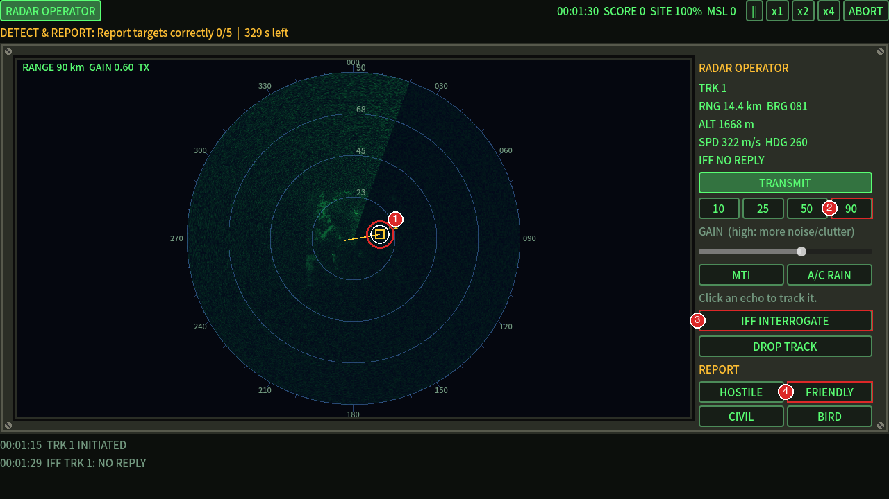

# TEST-2 LONGEYE 튜토리얼

장거리 조기경보 레이더 한 대로 혼자 운용하는 가상 장비. **카메라도 무기도 없다.** 레이더 영상과 IFF, 항적(속도·고도)만으로 항적을 분류해서 HQ에 보고하는 것이 임무다. (미션은 SUPPORT 또는 DETECT & REPORT가 선택 가능하고, 무장이 필요한 INTERCEPT는 선택할 수 없다.)

| | |
|---|---|
| 오퍼레이터 | 레이더 1명 |
| 레이더 | 최대 90 km(RCS 1 m² 기준), 6초에 1회전 (Sentinel보다 느리다) |
| 센서 | 레이더 + IFF 질의기 |

기본 조작(에코 읽기, 게인, MTI, 비 필터, 트랙 생성)은 [Sentinel 튜토리얼의 레이더 부분](tutorial_sentinel.md#1-레이더-오퍼레이터--에코-찾기)과 같다. 이 문서는 Longeye에서 달라지는 점을 다룬다.

## 화면

- ② **90 km 스케일**(Longeye는 기본이 90 km): 지도(51 km 정사각형) 전체와 그 바깥까지 보인다. 먼 표적을 일찍 잡을 수 있지만 같은 화면 크기에 더 많은 거리를 담으니 가까운 표적은 작게 보인다. 가까운 곳은 25/10 km로 바꿔서 본다.
- 안테나가 6초에 한 바퀴 돌기 때문에 에코가 갱신되는 간격이 길다. **표적이 두 번 이상 나타나야 속도·방향이 계산된다.** 트랙을 만든 뒤 한두 바퀴 기다리자.
- 화면의 ①은 이미 트랙을 만든 항적이다(T1, 거리 14 km, 속도 322 m/s, 고도 1.7 km, IFF 무응답). 속도가 빠르고 낮은데 IFF 응답이 없으니 의심스럽지만, **아군 응답기 고장일 수도 있으니** HQ 무전과 대조해야 한다.
- 이 미션은 **야간**이다. 레이더는 밤낮 상관없지만, 맑고 광량이 낮은 밤·새벽에는 **대기 덕팅**이 생겨 수평선 너머와 산 뒤 음영 지역에도 약한 지상 반사가 보인다. 이때 낮은 고도의 표적이 평소보다 멀리서 잡히고, 지형 반사가 길게 늘어난다. 레이더 오퍼레이터가 무전으로 알려준다.

## 카메라 없이 식별하기

EO가 없으므로 트랙이 가진 정보로 판단해야 한다. 오른쪽 위 정보창에서 속도·고도·IFF를 본다. ③ **IFF INTERROGATE**를 누르면 질의 결과가 정보창에 표시된다.

| 단서 | 해석 |
|---|---|
| 속도 15 m/s 이하, 낮고 약한 에코 | 새 떼 |
| 고도 8~10 km, 속도 약 230 m/s, 강한 에코 | 민항기 |
| ③ IFF가 **CIVIL** | 민항기 확정에 가깝다 |
| ③ IFF가 **FRIEND** | 아군 |
| IFF **무응답** + 빠르고 낮음 | 적일 수도 있지만 **아군 응답기 고장(약 20%)**일 수 있다. HQ 무전과 대조하자 |
| 속도 약 55 m/s, 작고 낮음 | 드론 |

SUPPORT 미션에서는 HQ가 아군 복귀기의 방위·거리를 불러준다. 그 방위의 트랙에 IFF를 쏘고 무응답이어도 HQ가 알려준 위치·시간과 일치하면 아군으로 보고한다.

판단이 서면 ④ **보고 버튼**으로 분류한다. 정확하면 +100, 틀리면 −50, 이미 보고한 표적에 다시 보고하면 무시된다. 가짜 트랙(클러터를 잡은 트랙)에 보고하면 −50이다.

## 팁

- 새 항적은 가장자리(60~90 km)에서 먼저 잡힌다. 큰 스케일로 전체를 훑고, 에코를 잡으면 트랙을 만들어 둔 뒤 가까운 스케일에서 이어서 본다.
- 한 번에 트랙을 많이 만들면 보고 순서를 놓치기 쉽다. 보고를 마친 트랙은 **DROP TRACK**으로 정리한다.
- 비가 오는 날에는 비구름 속 에코가 약해진다. 필요하면 A/C RAIN을 켜고 게인을 조금 올린다.
- 목표 개수를 채우는 것이 목적이다(DETECT: 정확한 보고 5건). 불확실한 항적에 서둘러 보고하기보다 확실한 항적부터 보고하자.
