# TEST-1 SENTINEL 튜토리얼

레이더, EO(TV·열상), 사격통제 3명이 한 팀으로 움직이는 가상 단거리 방공 장비다. 여기서는 **INTERCEPT** 미션으로 "탐지 → 추적 → 식별 → 교전" 한 사이클을 따라 한다.

| | |
|---|---|
| 오퍼레이터 | 레이더 / EO / 사격통제 (상단 탭으로 전환) |
| 레이더 | 최대 60 km(RCS 1 m² 기준), 4초에 1회전 |
| EO | TV 18 km, 열상 14 km (날씨·시간에 따라 변함) |
| 무장 | 미사일 8발, 사거리 1.5~20 km |

## 0. 준비

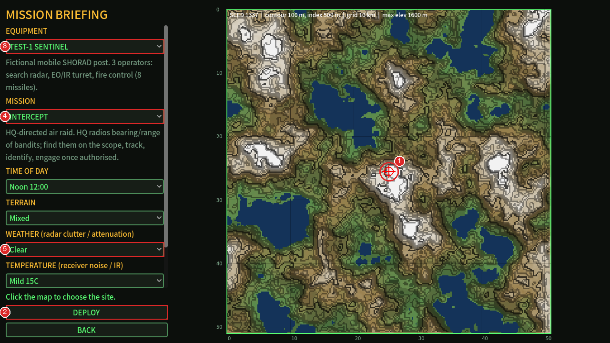

1. **지도** 위의 사이트 위치를 클릭한다(① 빨간 십자). 등고선은 100 m, 굵은 선은 500 m. **높은 곳**에 놓으면 레이더 음영이 줄지만, 능선 뒤 지형은 여전히 보이지 않는다. 바다에는 배치할 수 없다.
2. 장비(③), 미션(④), 날씨(⑤)를 고르고 **DEPLOY**(②)를 누른다.

시작하면 HQ 무전이 들어온다. 자막은 화면 아래에 영어(음성)와 한국어 번역으로 뜬다.

## 1. 레이더 오퍼레이터 — 에코 찾기

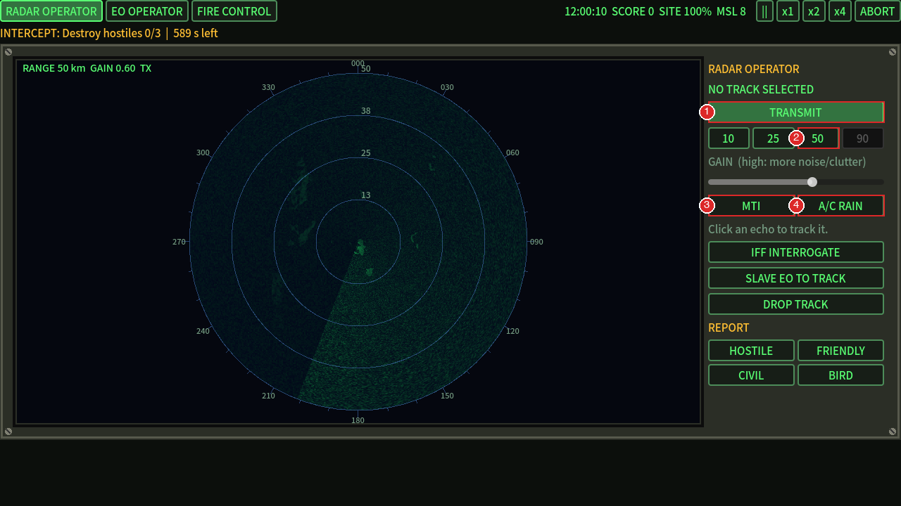

레이더 화면에는 **점 표시가 없다.** 안테나 빔(밝은 쐐기 모양 끝)이 시계 방향으로 돌면서 지나간 방위의 영상만 새로 그려지고, 오래된 영상은 한 바퀴 동안 서서히 어두워진다. 화면에서 직접 에코를 읽어야 한다.

| 보이는 것 | 의미 |
|---|---|
| 한 자리에 고정된 불규칙한 덩어리 | **지형 클러터**. 산·숲이 강하게 반사한다 |
| 클러터 뒤쪽의 검은 빈 곳 | **레이더 음영**. 산 뒤에 숨은 표적은 여기서 안 보인다 |
| 크고 부드러운 구름 모양, 천천히 흘러감 | **비구름** (날씨가 비/뇌우일 때) |
| 전체에 흩뿌려진 점 잡음 | 수신기 열잡음. 게인과 기온이 높을수록 많다 |
| 작은 밝은 점, 회전할 때마다 위치가 바뀌고 세기가 변함 | **표적 후보** |

### 조작

- ① **TRANSMIT**: 송신 ON/OFF. 끄면 화면이 꺼진다.
- ② **거리 스케일** 10/25/50/90 km (장비 최대 거리까지).
- **GAIN** 슬라이더: 올리면 약한 표적(드론 등)까지 보이지만 잡음과 클러터도 늘어난다. 내리면 깨끗하지만 작은 표적을 놓친다.
- ③ **MTI**: 움직이지 않는 클러터를 지운다. 대신 **느리거나 레이더를 가로지르는(접선 방향) 표적도 같이 약해진다.** 새 떼나 정지 비행하는 표적이 사라지면 MTI를 의심하자.
- ④ **A/C RAIN**: 비구름 에코를 줄인다(표적도 약간 약해진다).
- 커서를 올리면 왼쪽 아래에 그 지점의 **거리·방위**가 표시된다.

### 에코 잡기

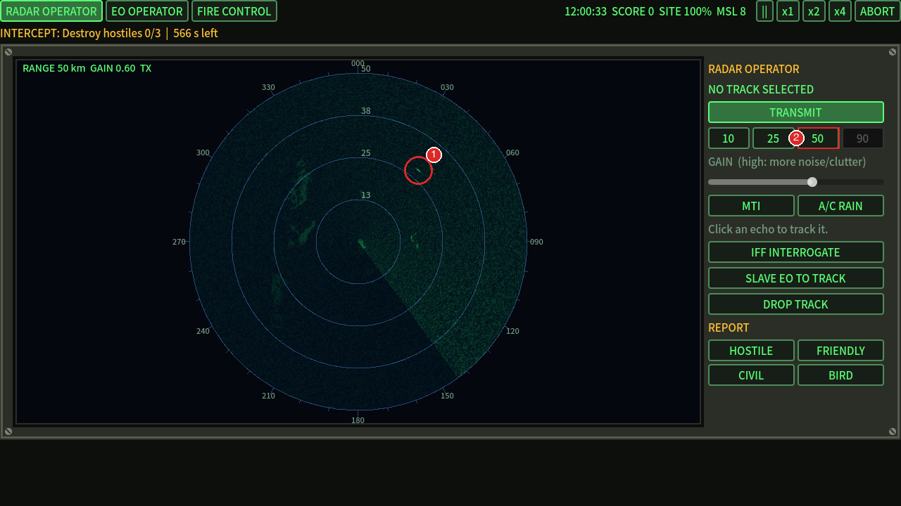

HQ가 "방위 040, 거리 28킬로"처럼 알려주면 그 방위를 집중해서 본다. 눈에 띄는 에코(①)를 **클릭**하면 트랙이 만들어진다. 에코가 최근에 갱신된 곳이어야 한다. 밝은 클러터를 클릭하면 **가짜 트랙**이 생기니 주의(보고하면 감점).

## 2. 식별

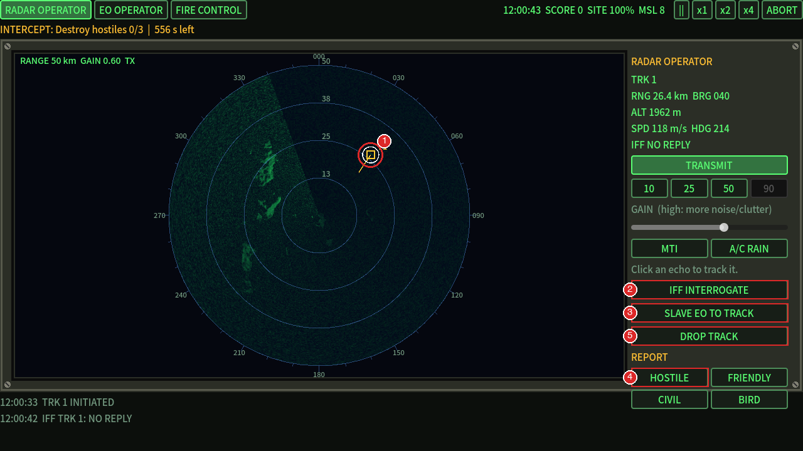

트랙(①, 번호 T1)이 생기면 이후 에코가 올 때마다 자동으로 갱신되며 속도·방향·고도가 계산된다. 12초 동안 에코가 없으면 트랙을 잃는다. 오른쪽 위 정보창에서 거리·방위·고도·속도·IFF를 확인한다.

**무엇으로 판단하나?**

| 단서 | 해석 |
|---|---|
| 속도 15 m/s 이하, 낮은 고도, 약한 에코 | 새 떼 |
| 속도 약 230 m/s, 고도 8~10 km, 강한 에코 | 민항기 |
| 속도 250~280 m/s, 낮은 고도에서 접근 | 전투기(적·아군 모두 가능) |
| 속도 약 55 m/s, 작고 낮음 | 드론 |
| HQ 무전의 방위·거리와 일치 | HQ 정보와 교차 확인 |
| ② **IFF INTERROGATE** 응답 | FRIEND / CIVIL 응답은 신뢰할 만하다. **무응답은 적이라는 뜻이 아니다**(아군 응답기 고장이 있다) |

판단이 서면 ④ **보고 버튼**(HOSTILE/FRIENDLY/CIVIL/BIRD)을 누른다. 정확하면 +100, 틀리면 −50. **HOSTILE로 지정하면(정답 여부와 상관없이) 사격통제가 그 트랙에 쏠 수 있다.** HQ가 먼저 적으로 선언하는 경우도 있다. 지정은 보고 버튼을 다시 눌러 **정정**할 수 있다(점수는 처음 보고에만 반영).

⑤ **DROP TRACK**은 트랙을 지운다. ③ **SLAVE EO TO TRACK**은 EO 카메라를 이 트랙으로 자동 지향시킨다.

## 3. EO 오퍼레이터 — 눈으로 확인

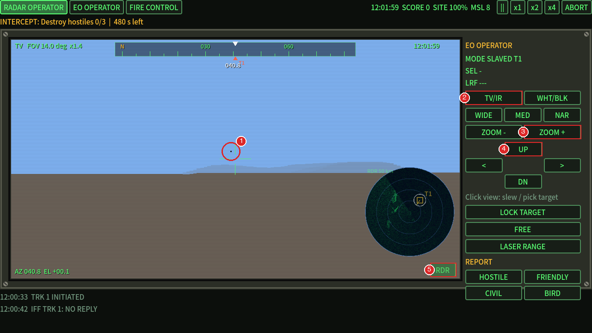

EO 탭으로 넘어가면 카메라가 트랙을 향해 돌아간다(SLAVE).

- **상단 방위 나침반**: 카메라가 향한 방위에 따라 움직인다. 중앙의 흰 삼각형이 현재 방위이고 아래 숫자가 정확한 값. N/E/S/W는 주황색, 30° 간격으로 숫자가 있다. 레이더에서 선택한 트랙이 있으면 **빨간 삼각형 + T번호**로 방위가 표시된다.
- ① 표적은 멀면 점으로만 보인다. 가까이 당겨야 실루엣이 보인다.
- ② **TV/IR**: TV는 낮에 좋고 밤에는 거의 쓸 수 없다. IR은 밤에도 열을 낸 표적(제트 엔진)을 본다. **WHT/BLK**로 백열/흑열 전환.
- ③ **줌**: WIDE/MED/NAR 프리셋, **ZOOM -/+** 버튼(누르고 있으면 연속), **마우스 휠**. 화각은 20°~0.8°.
- ④ **슬루 패드**(UP/DN/</>)는 누르는 동안 카메라가 움직인다. 줌이 깊을수록 느려진다. 화면의 빈 곳을 클릭하면 그 방향으로 지향한다.
- ⑤ **RDR 버튼**: 화면 오른쪽 아래의 **반투명(50%) 레이더 화면**을 켜고 끈다. 레이더 오퍼레이터가 맞춘 거리 스케일과 트랙이 그대로 보인다.

### 락온과 거리측정

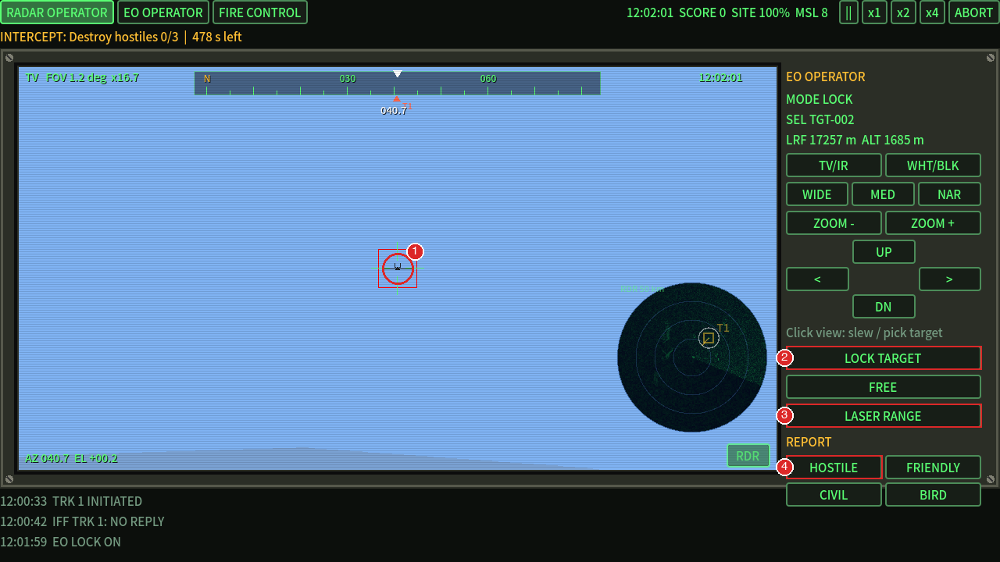

1. 표적(①)을 **클릭**해 선택한다(주황 박스).
2. ② **LOCK TARGET**: 표적을 자동 추적한다(박스가 빨강). 표적이 지형 뒤로 숨거나 거리를 벗어나면 락이 풀린다.
3. ③ **LASER RANGE**: 정확한 거리와 고도를 잰다(오른쪽 위 LRF).
4. ④ 실루엣, 속도, 고도를 종합해 보고한다.

실루엣 참고(가까이 당겨야 구분된다):

| 기종 | 특징 |
|---|---|
| 적 전투기 (FIGHTER-X) | **쌍발 수직꼬리**(정면에서 V자로 벌어진 두 꼬리), 큰 날개, 옆구리 흡입구 |
| 아군 전투기 (ALLY-F) | **단일 수직꼬리**, 둥근 버블 캐노피, 배 아래 흡입구, 날개 끝 레일 |
| 폭격기 | 길고 굵은 동체, 큰 후퇴익, 배 아래 엔진 포드 |
| 여객기 | 원통 동체와 **창문 줄**, 날개 아래 엔진, 높은 꼬리. 고고도에서는 **비행운**이 길게 남는다. 선회율이 낮아(약 3°/s) 큰 호를 그리며 천천히 방향을 바꾼다 |
| 드론 | 가늘고 매우 긴 직선 날개, 역V자 꼬리, 뒤쪽 프로펠러 |
| 새 떼 | 한 마리씩 날갯짓하는 V자 여러 마리 |

옆모습에서는 날개가 얇게 보인다. 표적이 사이트 거의 바로 위(올려다보는 각도 40° 이상)를 지나면 **아래에서 본 평면도**로 보이고, 화면에서 움직이는 방향대로 기울어져 보인다. 이것은 기동이 아니라 시점 때문이다. 정면·후면에서는 날개 폭과 꼬리 모양으로 구분한다. 열상(IR)에서는 후방 뷰에서 엔진이 하얗게 타오른다.

## 4. 사격통제 — 요격

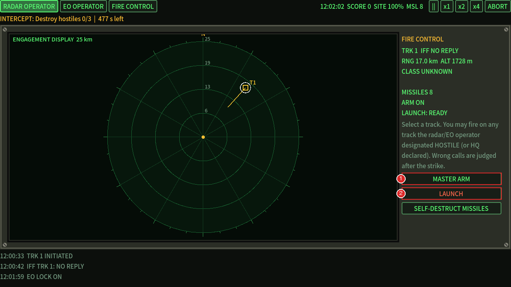

사격통제 탭에서 교전 표시기(25 km)의 트랙을 클릭해 선택한다.

1. 정보창에서 **LAUNCH: READY**가 뜨는지 본다. 불가 사유가 그대로 표시된다.

| 표시 | 뜻 |
|---|---|
| WEAPONS HOLD - NOT DESIGNATED HOSTILE | 아직 아무도 적으로 지정하지 않았다. 레이더/EO 오퍼레이터가 HOSTILE로 보고하거나 HQ가 선언해야 한다 |
| OUT OF RANGE / TOO CLOSE | 사거리(1.5~20 km) 밖 |
| TRACK STALE | 트랙이 4초 이상 갱신 안 됨 |
| NO MISSILES | 탄 소진 |

2. ① **MASTER ARM**을 켠다.
3. ② **LAUNCH**를 누른다. 발사하면 ARM이 자동으로 꺼진다.

### 미사일 궤적

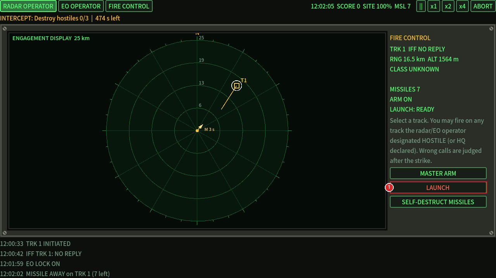

비행 중인 미사일은 **화살표(머리) + 주황색 궤적**으로 표시되고 옆에 비행 시간이 나온다. 미사일은 처음에는 레이더 트랙으로 유도되고, 표적과 4 km 안으로 들어오면 자체 탐색기로 전환한다. 명중 확률은 85%.

### 교전 후 평가와 경고

오퍼레이터가 적으로 지정했다면 민항기·아군기·새에도 쏠 수 있다. 대신 **타격 뒤에 평가**한다. 오인 격추는 아군 −300, 민항기 −500, 새 0이고 HQ가 평가 무전을 보낸다.

**알고 쐈다면 더 무겁다.** IFF가 FRIEND/CIVIL로 응답했거나 HQ가 그 기체를 브리핑했는데 발사하면, 발사 직후 HQ나 조기경보가 "사격 중지!" 하고 경고한다. 그래도 명중하면 아군 −200, 민항기 −300이 추가되고 "경고를 무시했다"는 질책이 따른다. 경고를 듣고 **SELF-DESTRUCT MISSILES** 버튼을 누르면 비행 중인 미사일을 파괴해 피해를 막을 수 있다. 임무 종료 화면에 교전 평가(격추/오인/경고 무시 횟수)가 표시된다.

EO 화면에서는 같은 미사일이 **엔진 불빛과 하얀 연기 궤적**으로 보이고(연기는 시간이 지나며 퍼지고 옅어진다), 비행이 끝나면 격추 지점에서 **백색 섬광 → 불덩이(주황·노랑 핵) → 충격파 고리 → 날아가 떨어지는 파편과 불꽃 → 솟아오르는 연기 기둥** 순으로 폭발이 펼쳐진다. 격추 실패(불발)는 작은 연기, 지형 충돌은 흙먼지로 구분된다. 열상에서는 불덩이가 하얗게 달아올랐다가 천천히 식는다. 카메라는 항상 장비(터릿)에 고정되어 있고 미사일을 따라가지 않는다. 미사일은 발사 직후 가파르게 올라가므로(몇 초 만에 올려다보는 각도 20° 이상) **락온을 풀고 카메라를 위로 돌려야** 보인다.

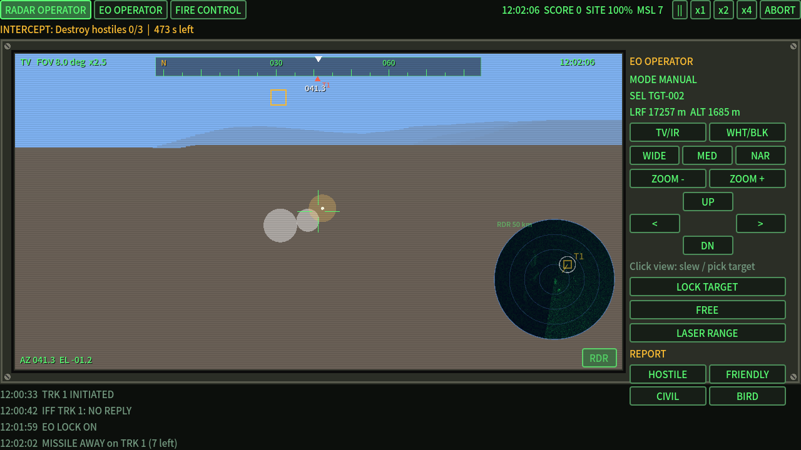

비행이 끝난 궤적은 15초 동안 남아 서서히 사라지며 끝점이 결과를 알려준다.

| 끝점 | 결과 |
|---|---|
| 빨간 **X** | 명중, 격추 |
| 흰 **원** | 폭발했지만 격추 실패, 또는 자폭 |
| 갈색 **네모** | 지형에 충돌(저고도 표적에 쏠 때 자주 발생) |

## 5. 날씨와 기온

비가 오면 레이더 화면이 이렇게 변한다.

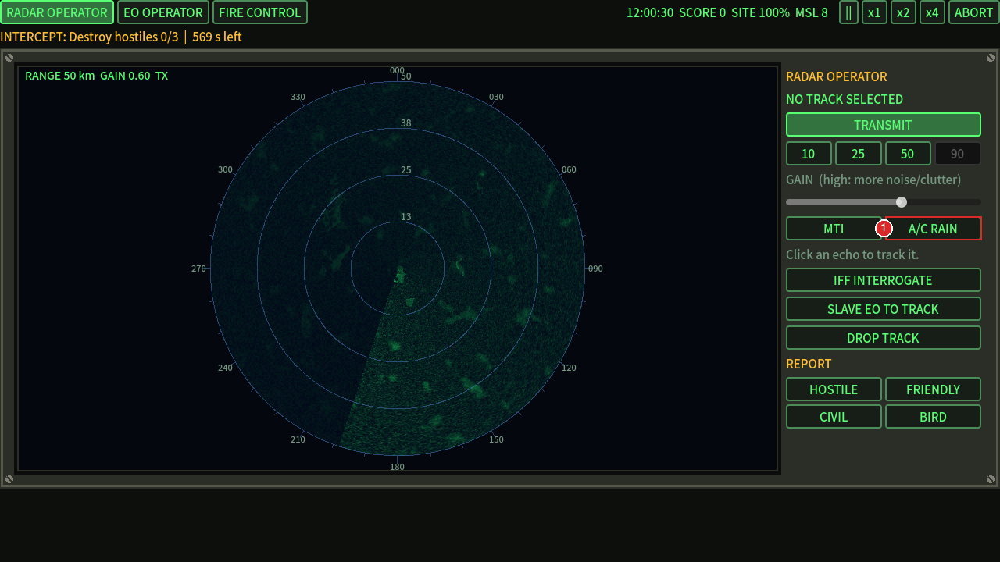

비구름 에코가 화면을 덮고, 표적 에코는 거리가 멀수록 약해진다(비 감쇠). **A/C RAIN**(①)을 켜면 비구름이 크게 줄어든다.

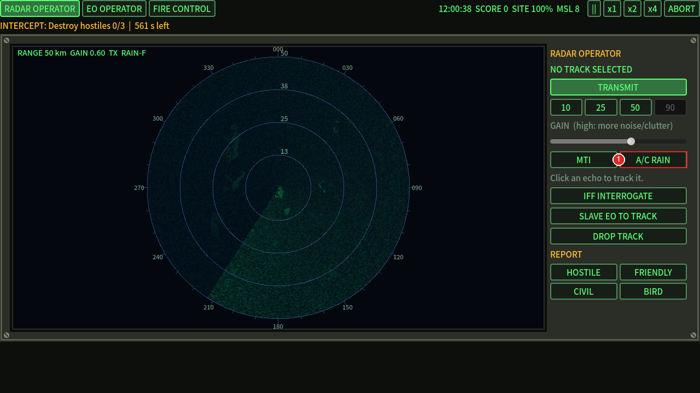

| 환경 | 영향 |
|---|---|
| 비 / 뇌우 | 비구름 에코, 표적 에코 감쇠. 뇌우는 번개 잡음까지 |
| 안개 | TV 시정이 크게 줄고 IR은 덜 줄어든다 |
| 고온 | 수신기 열잡음 증가, IR 사거리 감소 |
| 저온 | IR 사거리 증가 |
| 맑은 새벽·야간 | **대기 덕팅**: 수평선 너머·음영 지역에도 약한 지상 반사가 들어오고 저고도 표적이 더 멀리서 잡힌다 |

## 6. 무전

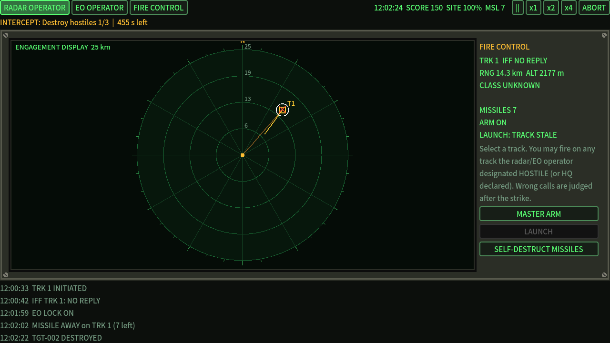

HQ와 분대원의 무전이 계속 들어온다. 영어 음성이 나오고 자막은 영어(크게)와 한국어(작게)로 뜬다. 방위·거리는 숫자를 한 자리씩 읽는다(예: "bearing zero four zero"). 보고에는 반올림과 오차가 있으니 **HQ가 불러준 숫자는 탐색 힌트**로만 쓰자.

## 7. 팁

- HQ가 알려준 방위를 레이더 화면에서 먼저 확인하고, 에코가 없으면 게인을 올리거나 MTI를 끈다.
- 낮게 나는 표적은 음영과 클러터 속에 숨는다. 가까워질 때까지 안 보일 수 있으니 사이트를 높은 곳에 잡자.
- 교전 전 **IFF + EO 실루엣 + 속도·고도**를 모두 확인한다. 아군/민항기 오사는 큰 감점이다.
- 미사일은 8발뿐이다. 새 떼에 쏘지 말자.
- 시간 배율(x2, x4)로 기다리는 시간을 줄일 수 있다.
