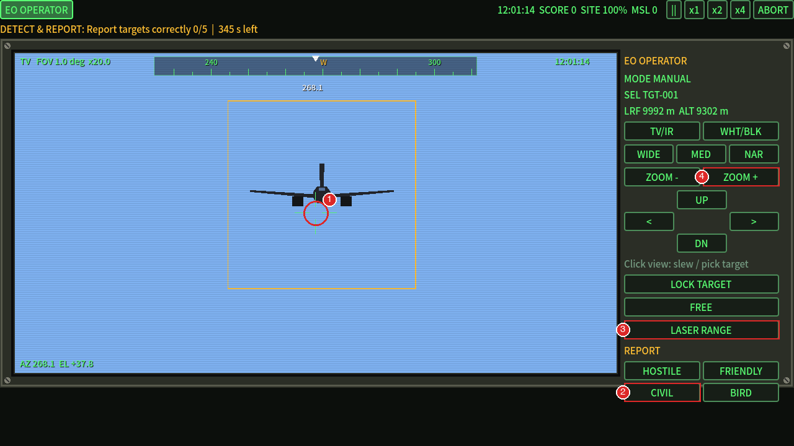
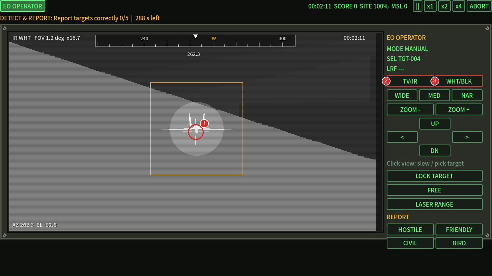

# TEST-3 WATCHPOST 튜토리얼

**레이더가 없는** 가상 관측 초소. EO(TV·열상) 카메라 하나로 하늘을 직접 수색하고, 보고한다. 무장은 없다. (미션은 SUPPORT 또는 DETECT & REPORT.)

| | |
|---|---|
| 오퍼레이터 | EO 1명 |
| 카메라 | TV 22 km, 열상 16 km (날씨·시간·표적에 따라 줄어듦) |
| 줌 | 화각 20° ~ 0.8° 연속 |

레이더 화면이 없으니 표적이 어디 있는지는 **HQ 무전의 방위·거리**와 카메라 수색으로 찾는다.

## 1. 수색하는 법

1. HQ가 "방위 230, 거리 25킬로"라고 하면 상단 **방위 나침반**에서 그 방위가 가운데 오도록 카메라를 돌린다. 나침반 테이프는 카메라를 돌리는 대로 흘러가며 중앙의 흰 삼각형 아래 숫자가 현재 방위다. N/E/S/W는 주황색.
2. **광각(WIDE, 화각 20~14°)**에서 하늘을 훑는다. **슬루 패드**(UP/DN/</>)는 누르고 있는 동안 움직이고, 화면의 빈 곳을 클릭하면 그 방향으로 지향한다. 줌이 깊을수록 느리게 움직인다.
3. 멀리서는 표적이 **한두 픽셀의 점**으로만 보인다. 점을 발견하면 클릭해서 선택(주황 박스, ①)한 뒤 **ZOOM +**(④)나 **마우스 휠**로 당긴다.
4. 지평선과 능선(산 실루엣, 가까운 숲의 나무선)이 보인다. **낮게 나는 표적은 능선 뒤에 숨는다.** 산 뒤로 사라졌다면 능선 위로 다시 나타나기를 기다린다.

## 2. 식별

충분히 당기면 실루엣이 보인다. 위 화면은 정면에서 본 여객기다(양옆으로 뻗은 날개, 날개 아래 엔진 2개, 높은 꼬리). 표적이 사이트 바로 위를 지날 때(올려다보는 각도 40° 이상)는 아래에서 본 평면도로 바뀐다.

| 실루엣 | 분류 후보 |
|---|---|
| 원통 동체와 창문 줄, 날개 아래 엔진, 높은 꼬리, 높은 고도의 **비행운** | 민항기 |
| **쌍발 수직꼬리**의 날렵한 기체 | 적 전투기 |
| **단일 수직꼬리**와 둥근 캐노피 | 아군 전투기 |
| 길고 굵은 동체에 큰 후퇴익 | 폭격기 |
| 가늘고 매우 긴 날개, 역V자 꼬리, 뒤쪽 프로펠러 | 드론 |
| 날갯짓하는 V자 여러 마리 | 새 떼 |

- ③ **LASER RANGE**: 선택한 표적의 **정확한 거리와 고도**를 잰다(오른쪽 위 LRF). 고도와 크기는 분류의 강한 단서다(고도 9 km면 민항기일 가능성이 높다).
- 전투기는 꼬리 수(쌍발 vs 단일)로 적/아군을 가릴 수 있지만 **멀거나 정면/후면에서는 구분이 어렵다.** HQ가 알려준 아군 편대의 방위·시간과도 대조한다.
- **LOCK TARGET**으로 표적을 자동 추적하면 카메라가 따라가므로 편하다. 표적이 능선 뒤로 가거나 거리를 벗어나면 락이 풀린다.

판단이 서면 ② **보고 버튼**(HOSTILE/FRIENDLY/CIVIL/BIRD)을 누른다. 정확하면 +100, 틀리면 −50.

## 3. 밤에는 열상(IR)

해가 진 뒤 TV(②)는 거의 쓸 수 없다(화면에 "LOW LIGHT - USE IR" 경고). **TV/IR** 버튼으로 열상으로 바꾼다.

- 열상은 열을 내는 표적을 밝게 보여준다. **엔진이 뜨거운 전투기·폭격기는 아주 밝게**(후광까지) 보이고, 드론이나 새는 어둡다.
- ③ **WHT/BLK**로 백열(뜨거운 것이 흰색)과 흑열(뜨거운 것이 검은색)을 바꾼다. 하늘 배경에서는 보통 백열이 눈에 잘 띈다.
- 기온이 낮을수록 열상 사거리가 길어지고 기온이 높을수록 줄어든다. 안개나 비에서는 TV 시정이 크게 줄고 열상은 덜 줄어든다.

## 4. 팁

- **방위 나침반으로 수색 범위를 기억하자.** "230~260°를 훑었으니 이제 260~290°".
- 줌을 너무 깊게 하면 시야가 좁아져 표적을 놓친다. 발견은 광각, 식별은 협각.
- 한 표적에 한 번만 보고할 수 있다.
- 시간 배율(x2, x4)로 표적이 올 때까지 기다리자.
